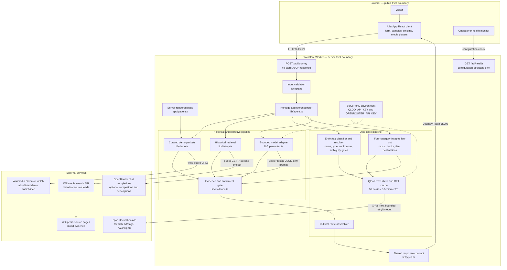
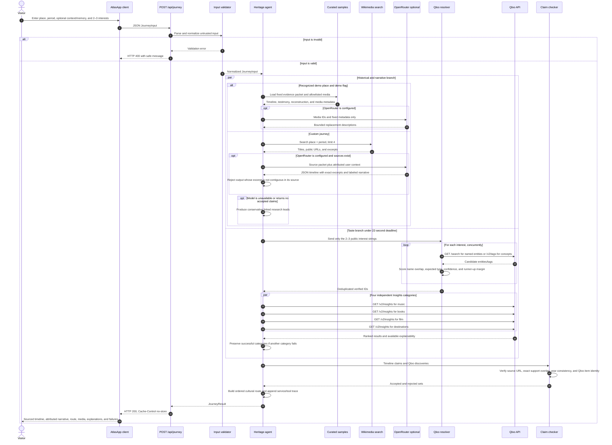

<div align="center">

# Jagantara

### AI-powered cultural heritage discovery

[](./LICENSE)

**Core API and runtime**

[](https://www.qloo.com/)
[](https://api.wikimedia.org/)
[](https://workers.cloudflare.com/)

**AI and LLM providers**

[](https://openrouter.ai/)
[](https://www.deepseek.com/)

**Historical and media providers**

[](https://www.wikipedia.org/)
[](https://commons.wikimedia.org/)
[](https://creativecommons.org/)
[](https://creativecommons.org/publicdomain/)

**Application stack**

[](https://www.typescriptlang.org/)
[](https://react.dev/)
[](https://nextjs.org/)
[](https://vite.dev/)

<p align="center">
  
</p>

</div>

## About

Jagantara is an AI agent powered cultural heritage explorer that connects family memories and historical evidence with personalized, playable media and cultural discoveries.

Jagantara is open-source software released under the [MIT License](./LICENSE), allowing reuse, modification, and distribution under the license terms.

The account-free judge journey offers four disclosed fictional samples: Native American history centered on Tahlequah and the Cherokee Nation, Irish and Italian immigration in New York, and African American history in Harlem. The samples do not claim ancestry, and every historical claim links to a retrievable source. Swapping the taste lens keeps a selected sample’s facts byte-for-byte stable while sending a different set of resolved Qloo entity IDs to Insights.

Each sample also includes inline playable audio or video from Wikimedia Commons. Media URLs, creators, and free-license labels come from a fixed allowlist. When OpenRouter is available, it may refine the short descriptions using only that supplied metadata; it cannot add or replace player URLs.

## Why Qloo is indispensable

The historical layer anchors context while Qloo creates the primary deliverable: a cross-media cultural route with ranked music, book, film, and destination stops. Without Qloo, sourced history remains visible, but the central route is explicitly unavailable rather than fabricated.

The server workflow:

1. Validates and normalizes place, period, attributed personal context, memory, and 2–3 interests.
2. Starts historical composition and Qloo resolution concurrently under a 22-second Qloo deadline.
3. Sends named entities to typed `/search` and genres/cultural concepts to `/v2/tags`.
4. Scores candidates by normalized name overlap, expected type, confidence threshold, and runner-up margin; ambiguous results are rejected.
5. Calls four `/v2/insights` categories concurrently with verified entity/tag IDs; partial failures preserve successful categories.
6. Requires a supporting excerpt and validates year consistency plus lexical entailment instead of accepting URL presence.
7. Returns a visible tool trace and evidence type on every item.

Every output is persisted in the response as one of:

- `SOURCE_BACKED_HISTORY`
- `FAMILY_TESTIMONY`
- `QLOO_TASTE_CONNECTION`
- `CREATIVE_RECONSTRUCTION`

Jagantara never infers ethnicity or genealogy from a surname, and Qloo affinities are never described as historical proof or as an individual preference.

## System architecture

Jagantara is a stateless, account-free React application deployed as a Cloudflare Worker. Next.js route and component conventions are compiled by Vinext/Vite into the Worker bundle. The browser owns presentation state; all credentialed calls, evidence processing, and recommendation orchestration remain server-side.



### Component responsibilities

| Layer | Implementation | Responsibility |
| --- | --- | --- |
| Presentation | `components/atlas-app.tsx`, `app/globals.css` | Collect input, switch sample/taste profiles, render evidence labels, sources, Qloo explanations, agent trace, and public media. |
| HTTP boundary | `app/api/journey/route.ts` | Parse request JSON, invoke the agent, return `JourneyResult` with `Cache-Control: no-store`, and map invalid requests to HTTP 400. |
| Health boundary | `app/api/health/route.ts` | Report service configuration without returning keys or credential fragments. |
| Validation | `lib/input.ts` | Normalize lengths and whitespace, require place/period and 2–3 interests, reject surname-style identity prompts, and remove angle brackets. |
| Orchestration | `lib/agent.ts` | Run the historical/demo and Qloo branches, apply deadlines, assemble the cultural route, and emit a visible tool trace. |
| Historical retrieval | `lib/history.ts` | Search Wikimedia for up to four relevant pages and retain linked excerpts as evidence candidates. |
| Model adapter | `lib/openrouter.ts` | Optionally compose claims from supplied excerpts and refine demo-media descriptions; it cannot change media URLs, creators, or licenses. |
| Taste intelligence | `lib/qloo.ts` | Resolve typed entities/tags, reject weak or ambiguous matches, query four Insights categories concurrently, normalize explainability, retry bounded transient failures, and cache GET responses. |
| Evidence control | `lib/evidence.ts` | Require HTTP sources, check year consistency and lexical overlap for historical claims, and reject malformed history or Qloo items. |
| Curated samples | `lib/demo.ts` | Supply four fictional judge inputs, fixed historical packets, taste profiles, and allowlisted Wikimedia Commons media. |
| Runtime/build | `vite.config.ts`, Vinext, Cloudflare plugin | Compile Next.js-compatible React server/client environments into a Cloudflare Worker for Sites or local Wrangler execution. |

No database participates in the Jagantara request path. The `db/` and `examples/d1/` files are hosting-template scaffolding; the account-free MVP does not persist journey input or results. The only runtime cache is process-local and may disappear whenever the Worker instance is recycled.

## Detailed data flow



### Data classification and trust rules

| Data | Destination | Retention/handling |
| --- | --- | --- |
| Place and period | Jagantara Worker; Wikimedia; optional OpenRouter | Used to retrieve and compose historical context. Not written to a Jagantara database. |
| Connection and memory | Jagantara Worker; optional OpenRouter | Kept attributed as testimony or reconstruction input. Never sent to Qloo. |
| Cultural interests | Jagantara Worker; Qloo | Limited to three public-interest strings, resolved to verified Qloo IDs, and held only in the response/process cache context. |
| Qloo API key | Qloo only, from the Worker | Server-side secret sent as `X-Api-Key`; never serialized to the browser. |
| OpenRouter API key | OpenRouter only, from the Worker | Server-side Bearer token; never serialized to the browser. |
| Historical evidence | Browser and optional OpenRouter | Includes the source title, URL, bounded excerpt, and entailment result so provenance remains inspectable. |
| Demo media metadata | Browser and optional OpenRouter | URLs, creator, license, and attribution are fixed; only the short description may be refined. |

### Output assembly and failure semantics

The final `JourneyResult` contains the normalized input, location, accepted timeline, labeled narrative, Qloo discoveries, assembled cultural route, curated sample media when applicable, resolved taste signals, Qloo service state, agent trace, and generation timestamp.

- A missing or failed model does not invent historical claims; custom journeys fall back to linked research leads, while curated sample copy remains intact.
- Missing Qloo configuration leaves sourced history available but marks the cultural route unavailable.
- Qloo requests retry only transient network, 5xx, and 429 responses. A category failure does not erase successful categories.
- An empty, ambiguous, unauthorized, rate-limited, timed-out, or failed Qloo result is returned as an explicit service state; substitute recommendations are never fabricated.
- Historical items that fail the evidence gate are removed before the response. The agent trace reports accepted and rejected counts.

## Technology stack

- Next.js 16, TypeScript, and React 19
- Vinext and Vite 8 for the React server/client build
- Cloudflare Workers, Wrangler, and Sites hosting
- Qloo Hackathon API for typed taste intelligence and cross-domain recommendations
- Wikimedia search and linked Wikipedia pages for historical evidence retrieval
- Wikimedia Commons for curated, playable, freely licensed demo media
- Optional OpenRouter chat completions using the configured model
- Node test runner, Playwright, ESLint, and TypeScript for verification

## Local setup

Prerequisites: Node.js 22.13+.

```bash
npm ci
cp .env.example .env
npm run dev
```

Request a personal hackathon key using [Qloo’s API key request form](https://forms.gle/zz12orkLHTAneLGz6). Qloo provisions keys manually and sends them by email, typically within a few business days. Configure the received key as `QLOO_API_KEY` only in `.env` or the host’s secret manager. It is read only in server code and must never use a `NEXT_PUBLIC_` prefix.

Hackathon keys work only with `https://hackathon.api.qloo.com`. The client defaults to that URL and rejects staging, production, or URL paths supplied through `QLOO_BASE_URL`, preventing the wrong-environment 401 described in the official guide.

To enable model-assisted composition through OpenRouter, set `LLM_PROVIDER=openrouter`, `LLM_MODEL=deepseek/deepseek-v4.1-flash`, and `OPENROUTER_API_KEY` server-side. The adapter requests JSON output and disables model reasoning for this bounded composition step so the completion budget is reserved for the final evidence-linked response.

## Verification

```bash
npm test
npm run typecheck
npm run lint
npm run build
npm run test:e2e
```

Unit tests cover OpenRouter’s exact-excerpt contract, source entailment, tag/entity resolution, Qloo response shapes, 401/403/429 behavior, and taste invariants. Playwright covers the judge journey, axe accessibility, custom taste switching, and a 390px mobile viewport. Set `PLAYWRIGHT_BASE_URL` to run the same suite against a deployed origin.

To exercise the compiled Cloudflare Worker locally with the variables in `.env`:

```bash
npm start
```

The production-style server listens on `http://127.0.0.1:8787`. Check `GET /api/health` to confirm that Qloo and OpenRouter are configured; the endpoint reports configuration state but never returns credentials or credential fragments.

## Qloo contract and failure behavior

The implementation follows the current public Qloo documentation and hackathon kit:

- Hackathon base URL: `https://hackathon.api.qloo.com`
- Authentication: `X-Api-Key` request header
- Typed entity resolution: `GET /search?query=...&types=...`
- Genre/concept resolution: `GET /v2/tags?filter.query=...`
- Recommendations: `GET /v2/insights`
- Output category: `filter.type`
- Taste signals: `signal.interests.entities` and `signal.interests.tags`
- Explanation request: `feature.explainability=true`

The client retries only transient network/5xx/429 responses, honors a bounded `Retry-After`, caps each attempt at 6.5 seconds, isolates categories with `Promise.allSettled`, and enforces a 22-second end-to-end Qloo budget. No failure path substitutes recommendations.

The integration does not use legacy `/recs` or `/recommendations` endpoints. Only typed, scored, non-ambiguous Qloo entity or tag IDs are passed to Insights.

The parser accepts the documented `results.entities` shape and defensive variants observed across Qloo surfaces. Live verification still depends on the validity, quota, and permissions of the configured event-issued credential.

## Deployment

This repository includes `.openai/hosting.json` for Sites. Build and deploy with the Sites workflow, then set `QLOO_API_KEY`, `QLOO_BASE_URL`, `LLM_PROVIDER`, `LLM_MODEL`, and `OPENROUTER_API_KEY` as server-only secrets in the hosting secret manager and redeploy. On another compatible host, configure the same server-only values and run the production build.

The public host must expose `/api/journey` and `/api/health`; a static export is insufficient.

## Responsible-use notes

- Do not send names, email addresses, account IDs, exact location histories, or other personal data to Qloo.
- The optional memory is not sent to Qloo; only the explicitly selected public cultural-interest strings are searched.
- Wikipedia is a retrieval starting point, not a substitute for archival research. The UI always exposes the source URL.
- The sample memory is fictional and visibly disclosed.
- No audio is generated in the MVP; this was intentionally left after the core provenance workflow.

## License

Jagantara is released under the **MIT License**, a permissive open-source license. It allows anyone to use, copy, modify, merge, publish, distribute, sublicense, and sell copies of the project, including for commercial purposes.

Anyone redistributing the software or a substantial portion of it must preserve the original copyright notice and MIT permission notice. The software is provided **“as is,” without warranty of any kind**, and the authors or copyright holders are not liable for claims, damages, or other liability arising from its use.

Copyright © 2026 Jagantara contributors. Read the complete license text in [LICENSE](./LICENSE).

The MIT License applies to Jagantara's original source code and documentation. Third-party APIs, models, archival material, fonts, audio, video, and other media remain subject to their respective providers' terms and licenses. Each curated media item exposes its own creator, source, and license attribution in the application.
